# OpenX6 Desktop

Open-source mods for the Insta360 X6

> **You can install OpenX6 for the first time only on an X6 currently running stock 0.8.825 or 0.8.827.** Keep the camera on its early firmware until you install OpenX6. Use the official 1.2.36 download only as a build input on your computer. **Do not copy the official Insta360 firmware package to the SD card.**
>
> For a new camera, follow the [official X6 activation instructions](https://onlinemanual.insta360.com/x6/en-us/camera/first-use/download-activation). If the app requires a firmware update to activate, stop before accepting the update if you want to keep first-install compatibility.
>
> **After installing OpenX6, do not install official firmware through the Insta360 app or from an SD card.** There is currently no known reliable way to reinstall OpenX6 after returning to stock firmware. Use a compatible OpenX6 SD package for future updates.
>
> OpenX6 is an independent third-party project with no affiliation to Insta360. Flashing modified firmware can leave the camera unable to start and can cause loss of recordings or settings. Back up your footage and any existing Holder directory before installation. The software is provided as is, subject to the warranty and liability terms of the [project license](LICENSE) and applicable law.

Use OpenX6 Desktop to build and verify an SD update with the built-in features on your computer from official X6 1.2.36. To develop a camera feature of your own, start with the [module framework preview](#module-framework-preview).

[中文使用说明](README.zh.md) · [Module author guide](sdk/README.md)

[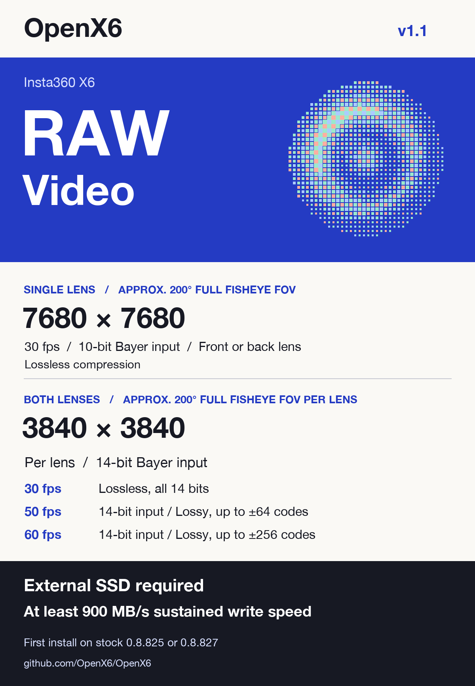](docs/images/openx6-launch.png)

[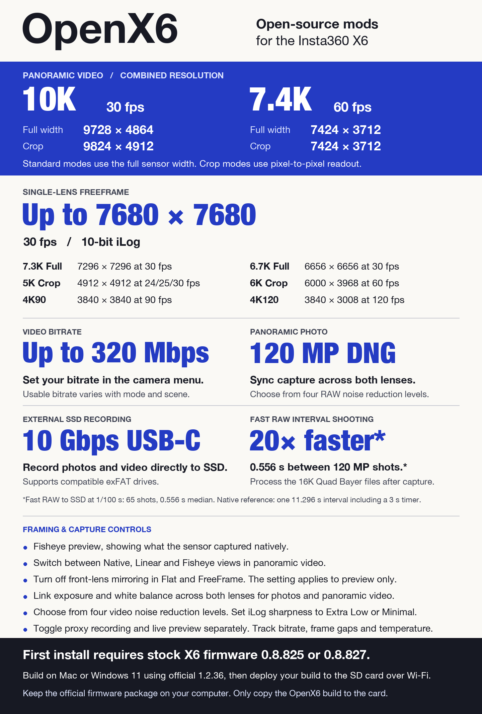](docs/images/openx6-launch-1.0.png)

The [component source audit](release/component-review.md) covers all 931 inputs. The checkout supplies 876 entries and generates 55 from the verified official image.

## RAW Video in 1.1

Connect a compatible external SSD, open **360 → RAW Video**, and tap the frame-rate control. Choose **30 Single Lens** for 7680 × 7680 lossless RAW10 at 30 fps. Switch between front and back with the lens button before recording. For both lenses, select **30, 50 or 60 fps**. Each lens records 3840 × 3840 with compression specific to its frame rate.

Both lenses deliver 14-bit Bayer samples (0–16,383). The frame rate determines how finely the file preserves those values.

| Lenses recorded | Per-lens format | Compression and precision | Estimated total sustained write |
| --- | --- | --- | ---: |
| One (front or back) | 7680 × 7680 · 30 fps | 10-bit Bayer input, lossless at every code value. | 870 MB/s |
| Both | 3840 × 3840 · 30 fps | Lossless. All 16,384 possible input values decode exactly. | 731 MB/s |
| Both | 3840 × 3840 · 50 fps | Lossy. Quantization steps range from 4 to 128 codes below 13,472. Maximum error is 64 codes. | 690 MB/s |
| Both | 3840 × 3840 · 60 fps | Lossy. Steps range from 8 to 512 codes below 13,472. Maximum error is 256 codes. Smooth sky gradients can show banding. | 626 MB/s |

At 50 and 60 fps, every input code from 13,472 to 16,383 is preserved exactly. Among the dual-lens modes, 30 fps retains the most detail in tone. The write figures are the camera’s initial estimates in decimal MB/s. Actual throughput varies with the scene, so allow headroom when choosing a drive.

Copy the **whole take folder** for editing. The `.x6b` contains Bayer frames. Audio, exposure, timing, motion and calibration are stored alongside it. Single-lens 8K takes require a desktop decoder with **X6S8B02** support. Detailed or noisy scenes can exceed a drive’s sustained write speed and drop frames.

## New recording modes

| Panoramic video | Combined width × height | Nominal frame rate |
| --- | ---: | ---: |
| 10K | 9728 × 4864 | 30 fps |
| 10K Crop | 9824 × 4912 | 30 fps |
| 7.4K | 7424 × 3712 | 60 fps |
| 7.4K Crop | 7424 × 3712 | 60 fps |

Standard modes use the full sensor width. Crop modes use pixel-to-pixel readout for a tighter view. The combined width is the sum of the two recorded lens tracks.

| Single-lens FreeFrame | Recorded width × height | Nominal frame rate |
| --- | ---: | ---: |
| 8K | 7680 × 7680 | 30 fps |
| 7.3K Full | 7296 × 7296 | 30 fps |
| 6.7K Full | 6656 × 6656 | 30 fps |
| 5K Crop | 4912 × 4912 | 24 / 25 / 30 fps |
| 6K Crop | 6000 × 3968 | 60 fps |
| 4K90 | 3840 × 3840 | 90 fps |
| 4K120 | 3840 × 3008 | 120 fps |

**Finding a FreeFrame mode.** In single-lens FreeFrame, tap the resolution and frame rate on the shooting screen, then tap **Ratio**. Select **1:1** for 8K, 7.3K Full, 6.7K Full, 5K Crop and 4K90. Select **4:3** for **4K120** or **6K Crop at 60 fps**. The table gives the recorded dimensions for each menu choice.

| 1:1 · 8K30 | 4:3 · 4K120 | 4:3 · 6K Crop 60 fps |
| :---: | :---: | :---: |
| 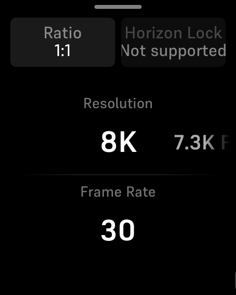 | 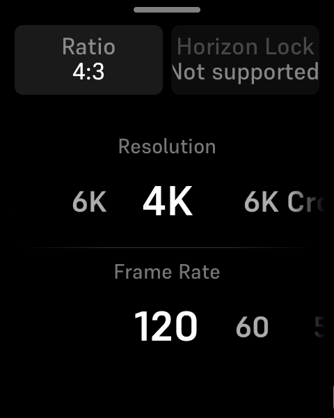 | 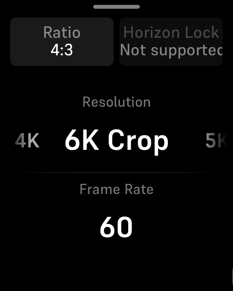 |

Crop modes and single-lens modes above 4K use the sensor’s small pixels. Expect more visible noise, especially in shadows or low light.

Single-lens FreeFrame records **up to 7680 × 7680 at 30 fps in 10-bit iLog**. Enable **Disable Video Proxy** for this mode. The full-rate proxy exhausted the capture buffers in a camera test. [Bitrate targets and mode limits](RELEASE_NOTES.md#higher-video-bitrates)

The Mac and Windows desktop tools build these capture modes from the official X6 1.2.36 package.

## Other capture features

- **Up to 320 Mbps** with a bitrate target you set in the camera menu. Usable bitrate depends on the mode and recording conditions.
- **Panoramic Photo** synchronizes 120 MP DNG capture across both lenses. Choose Native, Medium, Low or Minimal RAW noise reduction.
- **External SSD recording** for photos and video over 10 Gbps USB-C.
- **20× faster intervals.** At 1/100 s, 65 Fast RAW shots on SSD had a median start-to-start interval of **0.556 s**. The comparison uses one **11.296 s** interval between two native captures on SSD, including a 3 s timer after the first capture finished.

Camera Info displays `1.2.36 OpenX6 1.1`. **Stats Overlay** shows actual bitrate, encoder input-buffer return time, frame timestamp gaps and temperature. Tap the temperature row for sensor readings. Proxy recording and live preview can be switched off independently. The SD preparation panel reports verification and copy progress. Maintenance reinstalls replace the nine managed programs and preserve the camera’s enrolled Holder and settings.

**Choosing a recording bitrate.** Start with **Max**. It selects a preset for your recording mode and color profile, tuned for the highest bitrate that proved reasonably stable in testing. In **Stats Overlay**, **Return** is how long the encoder holds an input buffer. A sustained rise signals a backlog. **Gaps** counts missing frame intervals in the timestamps. Check both while recording, especially if you set **Custom** above Max. If Gaps keeps climbing in your scene, lower the bitrate.

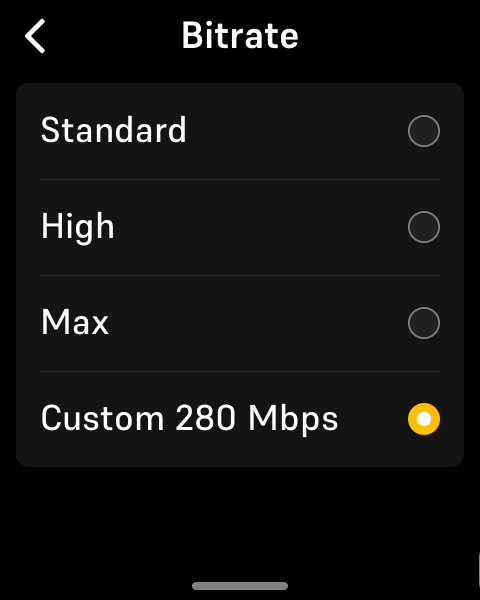

For iLog video, the sharpness menu includes **Extra Low** and **Minimal**. In **Mod Settings → Video Noise Reduction**, choose Native, Medium, Low or Minimal. RAW photos have their own noise reduction setting. For video, start with **Video Noise Reduction = Native** and **Sharpness = Low**. Reducing noise reduction leaves more noise for the encoder to compress. Very low settings can make compression artifacts more visible in detailed or moving scenes. Judge changes on a recorded clip at your intended bitrate.

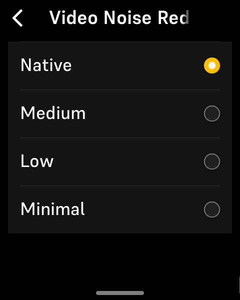

After installing this update, the camera asks you to confirm twice before handing a stock firmware update from the mobile app or SD card to the installer. Choose **Cancel** to keep OpenX6. Installing stock firmware removes OpenX6 and root access.

**Link Stereo AE / WB** links auto exposure and white balance between the two lenses for both photos and panoramic video, including 8K50.

**Fisheye preview, showing what the sensor captured natively.** The lower-left view menu offers Native, Linear and Fisheye in regular panoramic video. FreeFrame shows the selected lens. In regular panoramic video, you can switch between the front and rear lenses to frame each view. Fisheye framing follows the selected mode when recording starts or stops. In Flat and FreeFrame, **Disable Flat Mode Mirror** changes only the front-lens preview. The recorded video keeps its original orientation.


The legacy command service listens on the camera hotspot. A client on that hotspot can submit shell commands as root. The supplied client checks the camera identity, serial and connection authorization. The module exporter retains its separate factory-version check. [Wi-Fi command client](sdk/wifi-command/README.en.md)

OpenX6 Desktop starts in English. Choose **Language → 简体中文** to switch to Chinese or choose **English** to switch back. The app remembers your choice on this computer.

## 120 MP interval photos

In panoramic **Interval** mode, tap the capture settings at the bottom of the viewfinder. Choose **120MP** (16K, 1:1) and set **Format** to **RAW Only**.

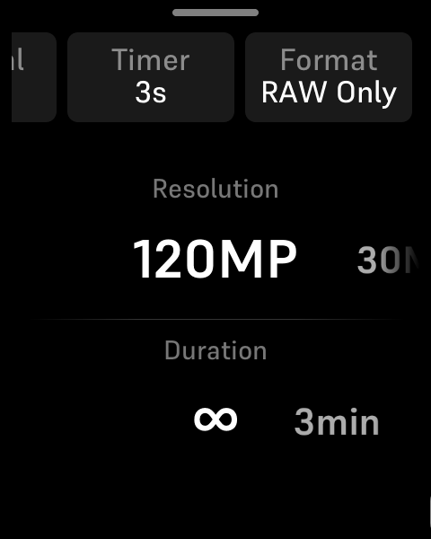

**1. Choose when to process the DNGs.** Open **Mod Settings → Interval Settings**. Turn **16K Fast RAW** on for short intervals. The camera saves the sensor’s Quad Bayer samples during capture and lets you convert them after the shoot. Leave it off for ready-to-edit DNGs. With Fast RAW off and **Interval Timing → Minimum**, four shots at 1/100 s on internal storage had a median start-to-start interval of **4.55 s**.

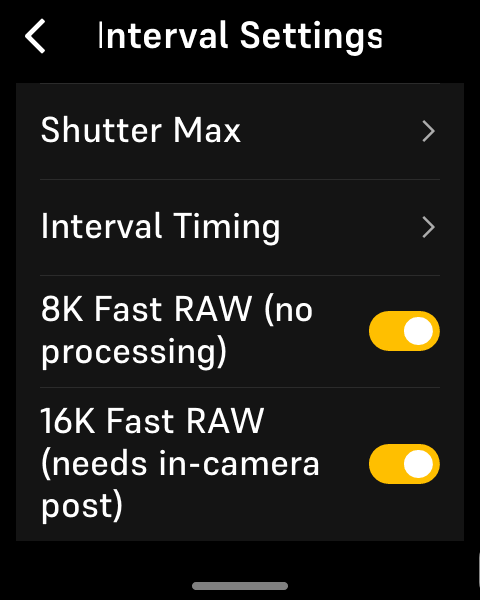

**2. Set the interval and shoot.** In **Interval Timing**, choose **Minimum** for the camera’s suggested target or **Custom** to enter a time in seconds. The target depends on the capture settings, and actual intervals can be longer. Return to the shooting screen and press the shutter to start the sequence. With 16K Fast RAW enabled at 1/100 s, 65 shots recorded to SSD had a median start-to-start interval of **0.556 s**.

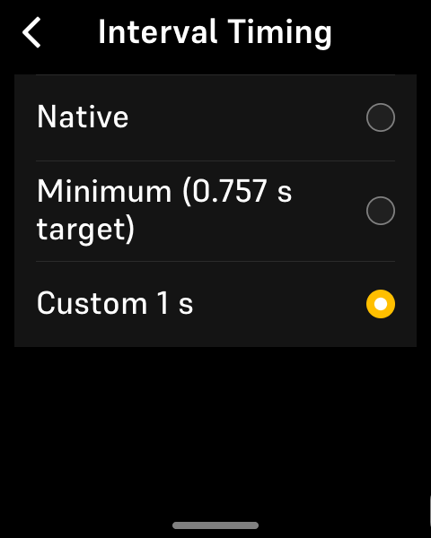

**3. Convert Fast RAW shots before editing.** After stopping capture, open **Mod Settings → 16K Fast RAW Processing**. Scroll down to select the groups you want, or tap **Select all pending**. If you want to keep the Quad Bayer originals, copy them before tapping **Start processing**. The camera converts the selected files in place to full-resolution standard Bayer DNGs. Check **Progress** and **Time left** on this page.

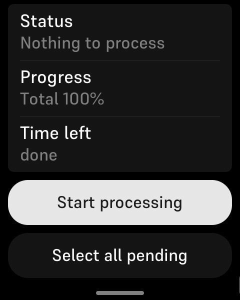

## First launch on macOS

Download `OpenX6-macOS-arm64.zip` from the OpenX6 release page. Double-click the ZIP in Finder to extract it on your Mac, then double-click **OpenX6.app**. This release is signed with Developer ID and notarized by Apple. The app includes its notarization ticket.

**“Apple could not verify OpenX6” or “unidentified developer.”** If you trust this release, click **Done**, then open **System Settings → Privacy & Security**. Under **Security**, find the message naming **OpenX6**, click **Open Anyway**, and confirm. The button can appear after the first blocked attempt. On a managed Mac, your administrator may restrict this option. [Apple’s guide to Mac app alerts](https://support.apple.com/en-us/102445)

**“OpenX6 is damaged and can’t be opened.”** Check the download and the extracted app before trying to open it again.

1. In Terminal, run `shasum -a 256 "$HOME/Downloads/OpenX6-macOS-arm64.zip"` (adjust the path if needed). Compare all 64 characters with the **Mac ZIP** entry in `SHA256SUMS` on the same OpenX6 release page. If they differ, download the ZIP again and repeat the check.
2. Once the hash matches, copy the ZIP to an empty folder on your Mac. In Finder, Control-click that copy and choose **Open With → Archive Utility**. Open Terminal in the folder containing the newly extracted **OpenX6.app** and run the following command.

   ```sh
   codesign --verify --deep --strict --verbose=2 ./OpenX6.app
   ```

3. Look for `valid on disk` and `satisfies its Designated Requirement`. These confirm the integrity of the signed bundle. If verification fails (for example, `a sealed resource is missing or invalid`), stop and report the error with the ZIP digest. If macOS says the app **will damage your computer** or reports malware, stop there as well.

To check the notarization as well, run `spctl --assess --type execute -vv ./OpenX6.app`. The expected result is `accepted` with `source=Notarized Developer ID`. If the app is still blocked, report the assessment output and ZIP checksum.

## Build an SD package on Apple Silicon

1. Open the packaged **OpenX6.app** on your Mac. Allow **20 GiB** of free space on a local disk. Python, Tk, the cross-compilers and ext4 tools travel with the app. It uses macOS’s built-in OpenSSH.
2. Select the [official 1.2.36 download](#supported-firmware-input) on your computer. Choose **Unpack on my X6** on stock **0.8.825 or 0.8.827**, or select a previously exported folder under **File → Choose saved module folder**.
3. Click **Build SD package** and choose an output folder on your computer. After verification, choose **Open output folder**, or use **Deploy to SD via Wi-Fi**. For Wi-Fi deployment, start with an SD card in the camera and no update files at the card root. Keep the X6 idle, connect to its hotspot, and confirm the serial suffix. OpenX6 transfers the signed build, reads it back on the camera and checks its digest before naming it `Insta360X6FW.bin`. Keep power connected. On stock 0.8.825 the tool also requests a scan of the card. Watch the camera for the update. If it stays idle and shows no update, restart normally with the card inserted. With USB power connected, the X6 may stop at the charging screen. Press Power briefly once to boot and scan the card. If an update is already in progress, let it finish. The local build stays in `OpenX6 SD Build/` under your chosen folder. **Do not copy the official Insta360 firmware package to the SD card.**
4. Back up **~/Library/Application Support/OpenX6/Holder** privately. It is created on the first build. Restore it in the same location before rebuilding on another Mac. A previously modified camera with a different holder may reject this signed update. Restore the identity its current updater trusts. A locally generated identity also supplies the first-install access keys.

Connect to your X6 hotspot, allow local network access and match the displayed serial suffix. Keep the camera awake and tap **Allow** on its screen if prompted. After camera approval, OpenX6 disables auto power-off and Wi-Fi auto-off and reads both preferences back before transferring any modules. The preferences stay in effect afterward. If disconnected, reconnect to the hotspot and retry. OpenX6 verifies and caches three modules. On the next launch, **Open cache folder** shows them in Finder at `~/Library/Application Support/OpenX6/Camera/X6-1.2.36-modules`. Future builds can reuse them with the original firmware while the camera is disconnected. Allow 2 GiB for the cache in addition to build space. On-camera unpack has been tested on a stock **0.8.825** X6. The **0.8.827** updater passed offline export tests. Export on a stock 0.8.827 camera still awaits verification.

## Build an SD package on Windows 11 x64

This Windows release has no Authenticode publisher signature. Download the ZIP and the matching `SHA256SUMS` from the [project releases](https://github.com/OpenX6/OpenX6/releases). Before extracting, run this PowerShell command in the download folder and compare the result with the Windows ZIP entry.

```powershell
Get-FileHash .\OpenX6-Windows11-x64-native.zip -Algorithm SHA256
```

Extract the entire native Windows ZIP to a local folder and double-click **OpenX6.exe**. In the main window, choose the [official 1.2.36 download](#supported-firmware-input). Click **Unpack on my X6** or use **File → Choose saved module folder**. A previously cached module folder is selected automatically. Click **Build SD package**, then choose an output folder and follow progress in the window. Allow at least 20 GiB on the output drive. The archive includes the build environment and dependencies. After verification choose **Open output folder**, **Deploy to SD via Wi-Fi**, or close the window. Wi-Fi deployment keeps the local build, checks the camera serial suffix, and renames the SD file only after readback verification. Stock 0.8.825 also receives an immediate scan request. Leave power and the card connected. If copying manually, copy only the generated `OpenX6 SD Build/Insta360X6FW.bin` to the root of the SD card. **Do not copy the official Insta360 firmware package to the SD card.**

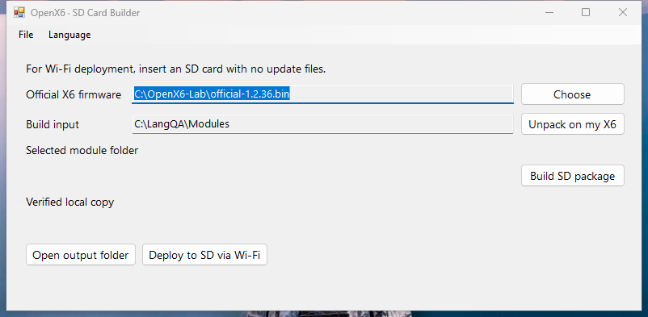

The default Windows cache is `%LOCALAPPDATA%\OpenX6\Camera\X6-1.2.36-modules`. Keep the three files together. Select this folder for offline builds on another PC. [Windows instructions and Holder backup](desktop-runtime/windows/NATIVE-HOLDER.md)

## Update the desktop app

On Mac and Windows, the desktop app checks for a newer stable release at startup. Choose **File → Update to …** to download, verify and start it. You can also use **File → Check for updates…**. Your Holder and camera module cache stay in place.

For a manual update, download your platform’s ZIP and `SHA256SUMS` from the same stable release. Compare the ZIP’s SHA-256 with its entry before extracting. On Mac use `shasum -a 256 OpenX6-macOS-arm64.zip`. On Windows use PowerShell `Get-FileHash .\OpenX6-Windows11-x64-native.zip -Algorithm SHA256`. [OpenX6 desktop releases](https://github.com/OpenX6/OpenX6/releases)

- **Mac:** Quit OpenX6, extract the new ZIP and replace the application in Applications. Follow the first-launch instructions above.
- **Windows 11 x64:** Close OpenX6, extract the entire new ZIP to a fresh folder and start its `OpenX6.exe` under the same Windows account. Update any shortcut to point to that folder.

Keep the Holder and module cache in their existing locations. Updating the desktop app takes effect on your computer. To update the camera, build and install a new SD package.

## Supported firmware input

Download `Insta360X6FW-338ADAFCENC.bin` to your computer from Insta360. Its size is **1,734,100,608 bytes** and its SHA-256 is `2c0b9685f2861455d9f248bf2b8897b24c8fba05dd79662deee0796b0dbd6853`. The product downloads page may feature a newer version. Use the version-specific link for this build. **Keep the official package off the SD card.** [Official X6 1.2.36 download](https://wassets.insta360.com/common/1903f1acc9b648e18c14b3457bcd8504/Insta360X6FW-338ADAFCENC.bin) · [Insta360 X6 downloads](https://www.insta360.com/us/download/insta360-x6)

Select the official encrypted X6 **1.2.36** package for either build profile. Desktop checks the entire file by SHA-256. It recognizes the official **1.3.59** package and stops before decryption. Choose 1.2.36 to continue. Files with unknown hashes are rejected even if renamed.

## Which cameras can install a release?

An installable OpenX6 release targets two groups:

- **First installation:** an X6 running factory **v0.8.825 or v0.8.827**. The installer checks the firmware version, updater SHA-256 and partition layout. A first installation succeeded on an X6 running stock v0.8.827. On-camera unpack on stock 0.8.827 has been verified offline only.
- **Subsequent updates:** an X6 already running a compatible OpenX6 build with its SD maintenance installer.

Stock **1.2.36** and **1.3.59** cameras reject this plaintext installation route. The firmware file you select on the Mac and the firmware currently running on the camera are separate requirements. The developer desktop produces install-locked candidates.

## If inserting the card does nothing

1. Check the camera firmware against the installation targets above. If the camera shows a check or an update in progress, keep the card and power connected and let it finish.
2. When the camera is idle, inspect the card on your computer. Place the **generated** `Insta360X6FW.bin` at the card root, with its exact name. Compare the file on the card with the `sha256` field in **your own build’s** `RESULT.json`. The desktop ZIP and the official firmware each have a different checksum.
3. On a previously used card, a leftover hidden `.x6-owner-package.bin` alongside the new `Insta360X6FW.bin` can prevent installation. In Finder press **Command–Shift–period**. In Windows Explorer choose **View → Show → Hidden items**. The simplest retry is a spare card with only the verified update at its root. To reuse the original card, back up the stale hidden file off-card first and remove it only after confirming both files are present and no update is running. A lone hidden file can belong to an update in progress.
4. Safely eject and reinsert the card with the camera powered. A completed installer intentionally ignores the same card left inserted through a reboot. If the camera stays idle, restart normally with the card inserted. If USB power leaves it at the charging screen, press Power briefly once.

## Update an existing OpenX6 installation

For a desktop tool update, quit the old application. Open the new app on Mac or fully extract the new Windows ZIP to a new local directory. Camera features take effect after the next SD installation.

1. Check the release notes for supported previous builds and the official input. For feature releases based on 1.2.36, reuse the original firmware and the verified camera module cache. Back up and reuse the entire `Holder` directory from your original build. On Mac, restore that backup first if you change computers. Windows identities use account-bound protection. The platform setup sections above give the backup locations.
2. On Windows, open the newly extracted OpenX6.exe under the same Windows account. The native app uses Windows DPAPI to protect the Holder in `%LOCALAPPDATA%\OpenX6\Native\Holder`. Users of an earlier WSL build should retain their original environment and Holder. Importing a WSL Holder into the native app is not supported.
3. Build an SD package with the new consumer tool in a fresh output location. Confirm that `RESULT.json` lists `Insta360X6FW.bin`, `installer_kind=guard-ready` and `install_allowed=true`. **Do not copy the official Insta360 firmware package to the SD card.** Copy only `OpenX6 SD Build/Insta360X6FW.bin` to the card root, safely eject the card and insert it into the camera. Keep the card inserted and the camera powered through staging, installation and restart. If it returns to the charging screen, power it on normally.
4. Feature updates can share an OTA version. Identify a build by the `release` and package digest in its own `RESULT.json` along with its release notes. After boot, check the new feature, your saved settings and the management access you use.

## Module framework preview

The module SDK and developer tools are a work in progress. The manifest format and menu interfaces may change. Try the [recording budget example](sdk/examples/recording_budget/module.json) to see what works today. Preview its camera menu on your computer, choose a bitrate, then run the example’s Python program to estimate how much space an hour of footage would use. This first step needs only Python and a copy of the repository. [Try your first module](sdk/README.md#create-your-first-module-with-python)

To test how modules fit together, select them in the developer tool, build from official 1.2.36 and inspect the menu, program and startup service in the finished package. Developer candidates are install-locked for offline review. Installable SD builds currently include the built-in modules only.

**Where we want to take this.** We want authors to be able to maintain the menu, code and tests for their own feature. For example, someone contributing a new interval setting could declare which firmware it supports, which value the camera should save and what to do when the photographer selects it. The core would handle firmware verification, check for conflicts and build and verify the package on the user’s computer. The longer-term goal is for users to choose compatible community modules alongside the built-in features when building an installable SD update in the desktop app.

## Developer preview on macOS

From the repository root, start a module with `python3 -B -m sdk init ../field_budget`, then check it with `python3 -B -m sdk check ../field_budget/module.json`. You can develop the menu and handler before selecting firmware. [Module quickstart](sdk/README.md#create-your-first-module-with-python)

1. Use an Apple Silicon Mac with Python 3.11 or later, Tk, OpenSSL 3 and e2fsprogs. Have these tools installed before going offline. To check Python and Tk, run `python3 -m tkinter -ApplePersistenceIgnoreState YES` and close its test window. Install OpenSSL 3 and e2fsprogs with your package manager if needed. OpenX6 discovers their Apple Silicon Homebrew locations, or uses e2fsprogs on PATH and a library specified by `OPENX6_LIBCRYPTO`. Reserve **20 GiB** on a local Mac filesystem for the build.
2. Select official X6 **1.2.36** and the folder of three modules exported by the consumer desktop. Keep the cache outside this repository.
3. Double-click **OpenX6 Desktop.command**, or run `python3 -B -m openx6.desktop` from this directory. Leave **Full OpenX6 build** unchecked. Choose the **Official firmware**, wait for the automatic check to finish and confirm it shows **Verified X6 1.2.36**. Then choose **X6 module folder**.
4. Click **Add JSON** and select [stock_debug_label.json](sdk/examples/stock_debug_label.json). Click **Build locked candidate** and choose a writable parent folder outside the repository. It must have room for the build and no existing `OpenX6 Build` subfolder. Keep the window open until it displays the verified output path.
5. In the resulting `OpenX6 Build` folder run `shasum -a 256 -c SHA256SUMS`. Open `RESULT.json` and check for `profile: stock-example`, the module ID `stock_debug_label`, `installer_kind: abort-only` and `install_allowed: false`. The candidate is for offline inspection. Both updater scripts abort unconditionally. Keep the candidate on your computer.

If the module folder is rejected, check that it contains exactly the three unmodified exported files. A module digest error can mean you selected the example for the other build profile. For a conflict, remove one module and retry. Changing the build profile clears the module selection.

After building a native menu, the developer window reconstructs it from the candidate and checks the packaged handler and service. Look for `Menu readback OK` and the selected module ID. The Windows 11 x64 acceptance kit uses the same 240 Mbps fixture. [Windows acceptance walkthrough in Chinese](desktop-runtime/windows/acceptance/WINDOWS-TEST.md)

## Full OpenX6 build (local review)

Enable **Full OpenX6 build**. Select the same firmware and module folder, and your **holder-public profile** (`owner-public.json`). For a first build, **Create holder** generates a profile and private keys in a new `OpenX6 Holder` folder outside the repository. Keep that entire folder private and backed up. For an existing identity, choose its original profile.

The full profile also needs OpenSSH with `ssh-keygen -Y`, Go **1.27.3**, LLVM clang and llvm-strip (tested with **22.1.4**), GNU-flavor LLD, and Zig **0.17.0**. Install the tools locally before building. Put Go and Zig on PATH. OpenX6 also checks the Homebrew llvm/lld locations and an installed stable rustup linker on macOS. You may set `OPENX6_LLD` to a GNU-flavor LLD executable.

Select [media_debug_label.json](sdk/examples/media_debug_label.json) to apply the example **after** the built-in bundle. Build and verify the checksums as above. Expect `profile: unified`, `installer_kind: guard-locked` and `install_allowed: false`. The full profile preserves the unified builder’s holder-aware components and installation guard. This release rehearsal covers construction and package inspection.

The builder verifies the signed component inventory with its preview public key. The separate project-update public key is used inside the generated image. Each 16K Fast RAW shot supplies its own color metadata and gain maps at conversion time. See the quality checks in the component source audit.

For a native settings example, add [the Stats menu module](sdk/examples/stats_overlay.json) in the full developer build. [SDK walkthrough](sdk/README.md#build-a-native-setting)

To add a setting with its own saved choices, start with [Field checklist](sdk/examples/field_checklist.json). You can preview it, build it alongside the Stats example, and read its saved value from another program. [Developer guide](sdk/README.md#add-a-module-owned-choice)

Developers can also package a Python program with a native choice. [Executable module walkthrough](sdk/README.md#run-your-own-program-from-a-menu-choice)

## License

OpenX6 Core, the desktop builders and the built-in camera modifications use GPL version 3 only. The module SDK, plugin template and bundled example plugins use Apache License 2.0. Upstream components retain their own licenses. [Core license](LICENSE) · [Plugin license](sdk/LICENSE) · [Scope and third-party notices](NOTICE.md)

## Credits

OpenX6 builds on research into Insta360 cameras, including the public work by derrickyau9 and contributors on the [Luna Ultra research project](https://github.com/derrickyau9/insta360-luna-ultra-reverse-engineering). Dependency notices accompany the vendored source. See [Notices](NOTICE.md).

Developer checks: run `python3 -B -m unittest discover -s tests` and `python3 -B -m unittest discover -s sdk` from the repository root. Both suites use local fixtures.

### Choose a boot mode with an SD card

Builds with this feature load mods on normal boots. To request a troubleshooting mode, create a plain text file named `OPENX6-BOOT.TXT` at the root of a writable SD card. Use a single line containing `LEVEL1` to skip mod services for one boot, `LEVEL2` for one rescue boot, or `NORMAL` to cancel a queued request.

With the camera on and out of USB File Transfer, insert the card, give the camera a few seconds to read it, then restart normally. The camera confirms acceptance by renaming the request to `OPENX6-BOOT.READY` with the same contents. A remaining `.TXT` file indicates an unconfirmed request. At the next ordinary restart after the protection boot, mods load again, even with the card still inserted.

The hotspot root command service on port 23456 is available in LEVEL2. Before marking a new slot successful, the camera verifies root locally through maintenance SSH or the hotspot service. Either can pass on its own. If both fail, the slot stays unmarked. The updater must also be idle.
