# OpenX6 Desktop

适用于 Insta360 X6 的开源改装工具。

> **首次安装 OpenX6 只支持机身当前运行原厂 0.8.825 或 0.8.827 的 X6。** 首装前请保留机身的早期固件。官方 1.2.36 只用于在电脑上构建 OpenX6。**不要把 Insta360 官方固件包拷入 SD 卡。**
>
> 新机请按[原厂 X6 激活说明](https://onlinemanual.insta360.com/x6/zh-cn/camera/first-use/download-activation)操作。如果 App 要求先升级固件才能激活，而你希望保留 OpenX6 首装兼容性，请停在升级确认前。
>
> **装好 OpenX6 后，请勿通过 Insta360 App 或 SD 卡刷回官方固件。** 刷回后，目前没有已知可靠的方法重新安装 OpenX6。后续更新请使用兼容的 OpenX6 卡刷包。
>
> OpenX6 是独立第三方项目，与 Insta360 无隶属关系。刷写修改版固件可能导致相机无法启动、素材或设置丢失。安装前请备份素材和已有的 Holder 目录。软件按现状提供，担保与责任条款见[项目许可证](LICENSE)，并受适用法律约束。

桌面工具可在电脑上用官方 X6 1.2.36 构建并校验包含内置功能的 OpenX6 卡刷包。想为相机开发新功能，可以从[模块框架开发预览](#模块框架开发预览)开始。

[English](README.md) · [模块开发说明](sdk/README.zh.md)

[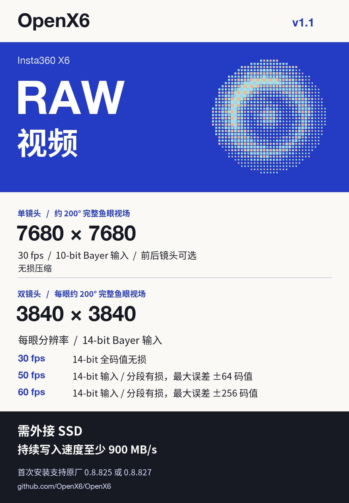](docs/images/openx6-launch-zh.png)

[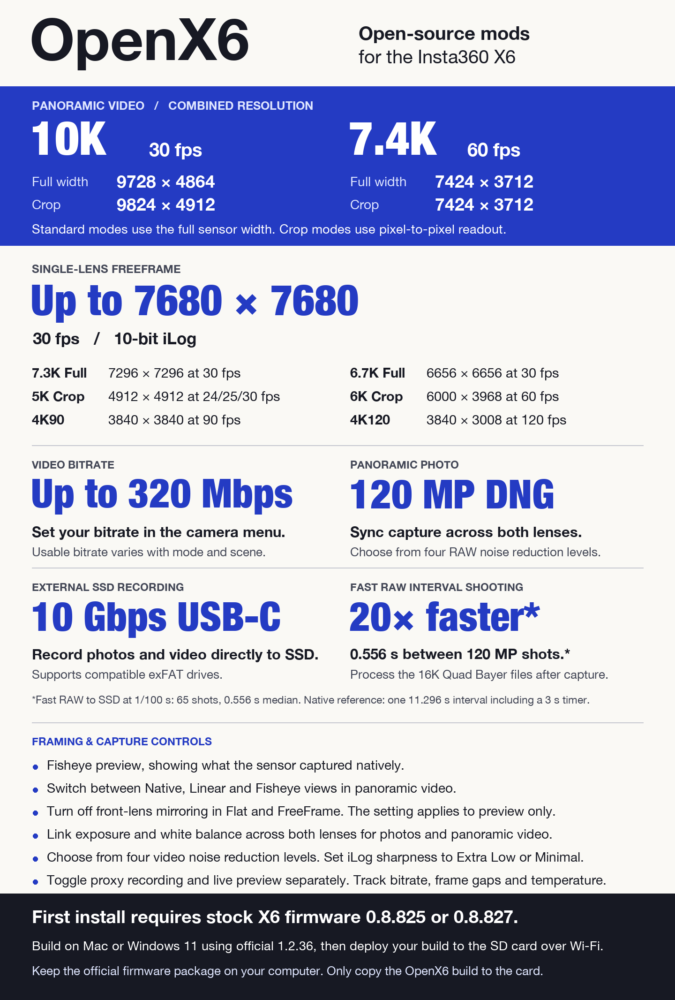](docs/images/openx6-launch-1.0.png)

[组件来源审查](release/component-review.zh.md)覆盖全部 931 项。其中 876 项来自仓库，55 项从已核验的官方镜像生成。

桌面工具首次启动默认显示英文。在菜单栏选择 **Language → 简体中文** 即可切换，之后也可以通过 **语言 → English** 切回。应用会在本机记住选择。

## 1.1 新增 RAW 视频

接上兼容的外置 SSD，进入 **360 → RAW Video**，点取景页底部的帧率。选 **30 Single Lens**，即可用取景页原有的镜头按钮选择前眼或后眼，录制 7680 × 7680、30 fps 的无损 RAW10。选 **30、50 或 60 fps** 则同时录下两眼，每眼 3840 × 3840，各帧率使用各自的压缩设置。

双眼三档都读取 14-bit Bayer，每个像素的输入码值范围为 0–16383。帧率决定文件能保留多细的色阶。

| 镜头 | 每眼规格 | 压缩与精度 | 参考持续写速（整机合计） |
| --- | --- | --- | ---: |
| 单眼（前或后） | 7680 × 7680 · 30 fps | 10-bit Bayer 输入，全码值无损。 | 870 MB/s |
| 双眼 | 3840 × 3840 · 30 fps | 无损。输入的 16384 个可能码值都能逐值还原。 | 731 MB/s |
| 双眼 | 3840 × 3840 · 50 fps | 有损。低于 13472 时按亮度分段，量化步长为 4 至 128 个码值，最大误差 64。 | 690 MB/s |
| 双眼 | 3840 × 3840 · 60 fps | 有损。低于 13472 时按亮度分段，量化步长为 8 至 512 个码值，最大误差 256。天空等平滑渐变更容易出现色阶。 | 626 MB/s |

50 和 60 fps 都完整保留 13472–16383 的每一个输入码值。双眼录制时，如果后期要大幅调整天空等渐变区域，30 fps 保留的色阶最完整。表中为相机的初始写速估算，按十进制 MB/s 计算；实际数据量随场景变化，选盘时应为持续写入留出余量。

后期请复制**整条素材文件夹**。`.x6b` 保存 Bayer 帧，同目录还保存音频、曝光、时间戳、运动和标定数据。单眼 8K 素材需要支持 **X6S8B02** 的桌面解码器。高细节或高噪点场景的数据量可能超过盘的持续写速，造成掉帧。

可用源码／脚本版 [X6B 转 CinemaDNG 工具](tools/x6b_to_cdng/README.zh.md)转换 1.1 已发布的 RAW 档位，音频和 metadata 一并保留。

## 新增录像档位

| 全景录像 | 双眼合计宽 × 高 | 标称帧率 |
| --- | ---: | ---: |
| 10K | 9728 × 4864 | 30 fps |
| 10K Crop | 9824 × 4912 | 30 fps |
| 7.4K | 7424 × 3712 | 60 fps |
| 7.4K Crop | 7424 × 3712 | 60 fps |

普通档使用传感器全宽，Crop 档逐像素读出，视角更窄。合计宽度是文件中两路镜头视频轨的宽度之和。

| 单镜头 FreeFrame | 文件实际宽 × 高 | 标称帧率 |
| --- | ---: | ---: |
| 8K | 7680 × 7680 | 30 fps |
| 7.3K Full | 7296 × 7296 | 30 fps |
| 6.7K Full | 6656 × 6656 | 30 fps |
| 5K Crop | 4912 × 4912 | 24 / 25 / 30 fps |
| 6K Crop | 6000 × 3968 | 60 fps |
| 4K90 | 3840 × 3840 | 90 fps |
| 4K120 | 3840 × 3008 | 120 fps |

**如何找到 FreeFrame 档位。** 切到单镜头 FreeFrame，点拍摄页下方的分辨率和帧率，再点 **Ratio（画幅）**。选 **1:1** 可找到 8K、7.3K Full、6.7K Full、5K Crop 和 4K90。要拍 **4K120** 或 **6K Crop 60 fps**，选 **4:3**。上表列的是各菜单档位实际录出的宽和高。

| 1:1 · 8K30 | 4:3 · 4K120 | 4:3 · 6K Crop 60 fps |
| :---: | :---: | :---: |
| 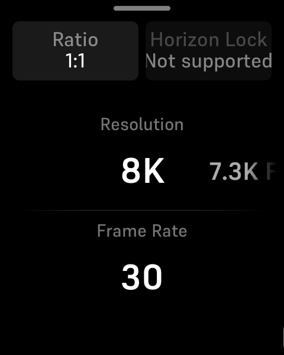 | 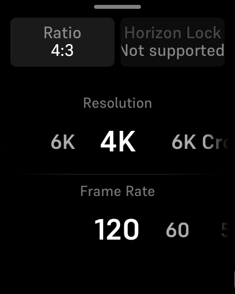 | 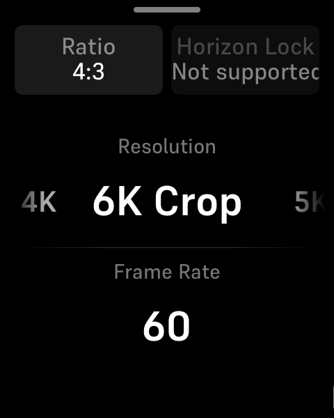 |

各 Crop 档和超过 4K 的单镜头档位都使用传感器的小像素。阴影和暗光处的噪点会更明显，这是这些读出模式的正常表现。

单镜头 FreeFrame 最高可录 **7680 × 7680、30 fps、10-bit iLog**。使用这一档时建议开启 **Disable Video Proxy**；实录中，全帧率代理曾耗尽缓冲。[各档码率和限制](RELEASE_NOTES.md#提升录像码率)

Mac 和 Windows 桌面工具均以官方 X6 1.2.36 包为输入，构建包含下列拍摄档位的卡刷包。

## 其他拍摄功能

- **录像码率最高 320 Mbps**，可在机身菜单中自定义。实际可用码率取决于档位和拍摄环境。
- **全景照片**支持 120 MP DNG 双眼同步拍摄，RAW 降噪可选 Native、Medium、Low 或 Minimal。
- **外置 SSD** 支持通过 10 Gbps USB-C 直接录制照片和视频。
- **间隔拍摄提速约 20 倍**。1/100 秒快门、Fast RAW 写入 SSD，连拍 65 张 120 MP DNG，相邻拍摄起点的间隔中位数为 **0.556 秒**。原厂策略对照只拍了两张，起点相隔 **11.296 秒**，包含上一张完成后定时等待的 3 秒。

Camera Info 显示 `1.2.36 OpenX6 1.1`。**Stats Overlay** 显示实际码率、编码器归还输入缓冲的耗时、帧时间戳缺格和温度。点温度行可展开传感器读数。代理录像和机身取景可独立关闭。SD 更新准备页显示校验与复制进度；维护重装可替换九个受管理的程序文件，保留相机自己的 Holder 和设置。

**录像码率怎么选。** 建议先选 **Max**。相机会按录像档位和色彩模式自动选用实测中能较稳定录制的最高预设码率。打开 **Stats Overlay**，观察 **Return**（编码器归还输入缓冲所用的时间）和 **Gaps**（按时间戳统计的缺帧数）。Return 持续升高说明画面开始积压；若 Gaps 持续增加，就降低码率。用 **Custom** 超过 Max 时尤其要留意，同一码率在不同光线、纹理和运动条件下表现可能不同。

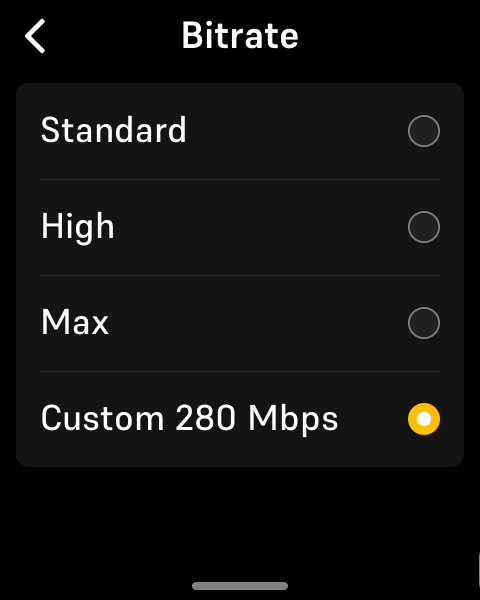

iLog 录像的锐度菜单新增 **Extra Low** 和 **Minimal**。在 **Mod Settings → Video Noise Reduction** 中可选择 Native、Medium、Low 或 Minimal。RAW 照片的降噪单独设置。视频推荐从 **Video Noise Reduction = Native（原厂降噪）**、**Sharpness = Low（低锐度）** 开始。降低降噪会留下更多噪点，增加编码负担。降噪和锐度设得过低时，纹理复杂或运动场景里可能更容易看见压缩伪影。调整后建议按实际使用的码率录一小段再判断。

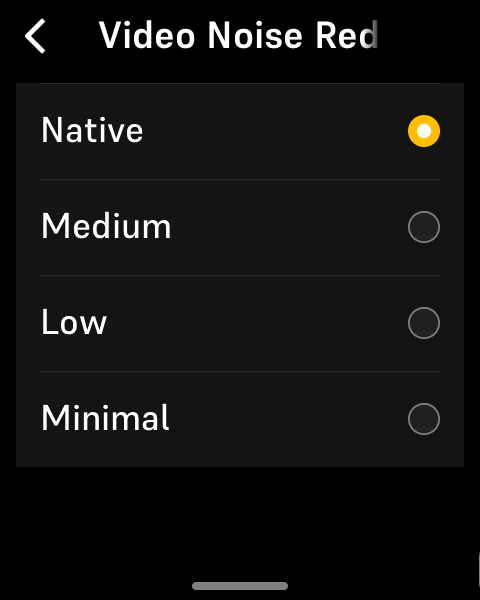

安装本次更新后，通过手机 App 或 SD 卡安装原厂固件，需要在机身上确认两次。要继续使用 OpenX6，请选「取消」。安装原厂固件将失去 OpenX6 和 root 访问。

**Link Stereo AE / WB** 在拍照和全景录像时都能联动前后镜头的自动曝光与白平衡，已实测 8K50 录像。

**Fisheye 鱼眼预览，显示传感器采集的原生鱼眼画面。** 普通全景录像的左下角视角菜单可选 Native、Linear 或 Fisheye。单镜头 FreeFrame 显示当前镜头的画面，普通全景录像可切换前后镜头，分别检查构图。开录和停录时，鱼眼取景跟随当前档位。Flat 和 FreeFrame 中的 **Disable Flat Mode Mirror** 只控制前镜头的机身取景，录制文件保留原方向。


兼容命令服务监听相机热点，连入该热点的客户端可以提交 root shell 命令。随附客户端会核对相机身份、序列号和连接授权。桌面机内解包工具独立检查出厂固件版本。[Wi-Fi 命令客户端](sdk/wifi-command/README.md)

## 120 MP 间隔拍照

在全景 **Interval（间隔拍照）** 取景页点下方的拍摄参数，选择 **120MP**（16K、1:1），再把 **Format** 设为 **RAW Only**。

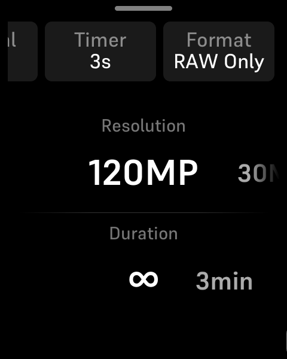

**1. 选择何时处理 DNG。** 进入 **Mod Settings → Interval Settings**。想缩短拍摄间隔，打开 **16K Fast RAW**，相机会先保存传感器的 Quad Bayer 原始数据，拍完再转换。想拍完就能编辑，则关闭它。在关闭 Fast RAW、选择 **Interval Timing → Minimum** 时，使用内置存储和 1/100 秒快门实拍 4 张，拍摄起点之间的间隔中位数为 **4.55 秒**。

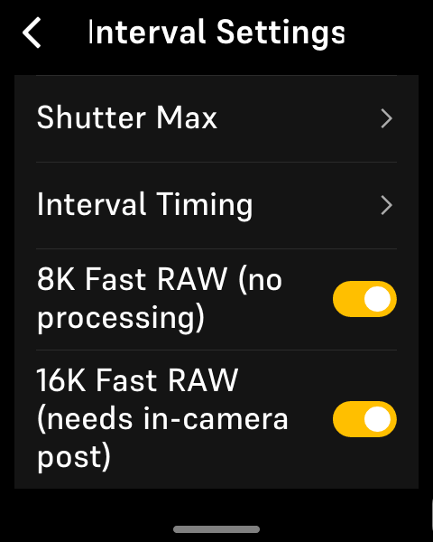

**2. 设定间隔并开拍。** 进入 **Interval Timing**，选 **Minimum** 使用相机建议的目标间隔，或选 **Custom** 自行输入秒数。目标值随拍摄设置变化，实际间隔可能更长。返回取景页，按快门开始间隔拍摄。开启 16K Fast RAW、以 1/100 秒快门写入 SSD 时，实拍 65 张，拍摄起点之间的间隔中位数为 **0.556 秒**。

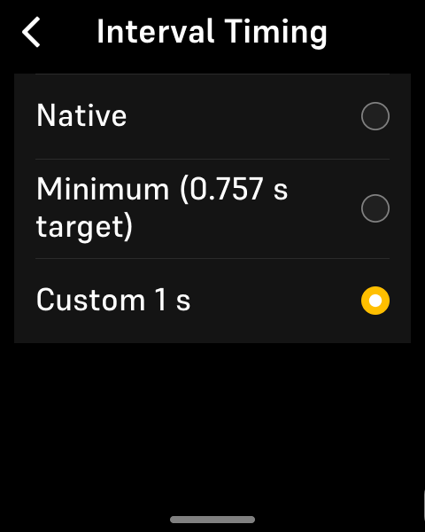

**3. 拍完转换 Fast RAW。** 停止拍摄后，进入 **Mod Settings → 16K Fast RAW Processing**。向下滚动选择要处理的拍摄组，或点 **Select all pending** 全选待处理组。想保留 Quad Bayer 原片，请先拷贝，再点 **Start processing**。相机会将选中的文件原地转换为可编辑的全分辨率标准 Bayer DNG。留在此页可从 **Progress** 查看总进度，从 **Time left** 查看剩余时间。

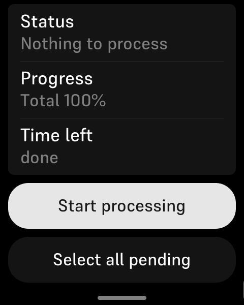

## 在 Mac 上首次打开

从 OpenX6 发布页下载 `OpenX6-macOS-arm64.zip`，在 Mac 本地磁盘上用访达双击 ZIP 解压，再双击 **OpenX6.app**。此版本已用 Developer ID 签名并通过 Apple 公证，应用内附公证票据。

如果提示**「Apple 无法验证 OpenX6」或「无法验证开发者」**，且你信任这次发布，先点「完成」，再进入**系统设置 → 隐私与安全性**。在「安全性」区域找到明确写有 **OpenX6** 的提示，点**「仍要打开」（Open Anyway）**并确认。这个按钮可能在首次打开被拦截后才出现。受管理的 Mac 可能由管理员限制此选项。[Apple 对 Mac 应用警告的说明](https://support.apple.com/zh-cn/102445)

**提示「OpenX6 已损坏，无法打开」**时，请先检查下载包和解压后的应用。

1. 在终端运行 `shasum -a 256 "$HOME/Downloads/OpenX6-macOS-arm64.zip"`（若下载到其他位置，请替换路径）。与同一 OpenX6 发布页 `SHA256SUMS` 中 **Mac ZIP** 对应的 64 位十六进制摘要逐字比对。若不一致，请重新下载并再次核对。
2. 摘要一致后，把 ZIP 复制到 Mac 本地的空文件夹。在访达中按住 Control 键点按这份 ZIP，选择**「打开方式」→「归档实用工具」**。在新解压的 **OpenX6.app** 所在文件夹打开终端，运行下面的命令。

   ```sh
   codesign --verify --deep --strict --verbose=2 ./OpenX6.app
   ```

3. 输出中的 `valid on disk` 和 `satisfies its Designated Requirement` 表示签名覆盖的应用内容完整。若校验失败，例如出现 `a sealed resource is missing or invalid`，请停止打开，并在反馈中附上错误原文和 ZIP 摘要。若系统提示应用**「将损坏你的电脑」**或检测到恶意软件，也请停止操作。

要同时检查公证状态，请运行 `spctl --assess --type execute -vv ./OpenX6.app`。预期输出包含 `accepted` 和 `source=Notarized Developer ID`。若应用仍被拦截，请在反馈中附上检查结果和 ZIP 摘要。

## 普通用户在 Apple Silicon Mac 上生成卡刷包

1. 打开打包好的 **OpenX6.app**，在电脑本地磁盘预留 **20 GiB**。Python、Tk、交叉编译器、ext4 文件系统工具已随应用提供，OpenSSH 使用 macOS 自带版本。
2. 选择已下载到电脑的[官方 1.2.36 固件](#构建使用哪个固件文件)。原厂 **0.8.825 或 0.8.827** 可选 **在我的 X6 上解包**；已有缓存时可从 **文件 → 选择已保存的模块目录** 打开。
3. 点「生成卡刷包」，选择电脑上的输出位置。构建完成后可点 **打开固件所在目录**。若想直接写卡，可在开始前将一张根目录没有升级包的 SD 卡插入相机。保持相机空闲并连接其 Wi-Fi，点 **通过 Wi-Fi 部署到 SD 卡**，核对目标机身后六位。工具将本次签名成品传到机内 SD 卡，读回校验成功后才命名为 `Insta360X6FW.bin`。保持供电。对于原厂 0.8.825，工具还会请求相机立即扫卡。若相机一直空闲且未显示升级，可留卡正常重启。接着 USB 电源时，若停在充电界面，短按一次电源键即可开机扫卡。若已显示升级进度，请等待完成。电脑上的成品始终保存在所选目录下的 `OpenX6 SD Build/`。**不要把 Insta360 官方固件包拷入 SD 卡。**
4. 首次构建时桌面工具会建立持有者身份。请私下备份整个 **~/Library/Application Support/OpenX6/Holder**。换 Mac 前把它恢复到同一位置。已有改装机若信任另一把签名公钥，可能拒绝新身份签发的包。请恢复该机原先信任的身份。新机首装的 SSH 和 GUI 访问使用本次构建的持有者身份。

电脑连接相机热点后，允许本地网络访问，核对机身序列号后六位。请保持相机开机，若机身弹窗，点「允许」。机身授权后，OpenX6 会先关闭自动关机和 Wi-Fi 自动关闭，逐项读回确认后才开始传输。两项设置在传输结束后保留；如中途断线，重新连接热点并重试即可。桌面工具会校验并缓存三个模块。 下次打开会自动选中缓存；点「打开缓存目录」可在 Finder 查看 `~/Library/Application Support/OpenX6/Camera/X6-1.2.36-modules`。以后可用原官方包和缓存离线构建。除构建空间外，请为缓存预留 2 GiB。原厂 **0.8.825** 已完成机内解包实测。**0.8.827** 的升级器已通过离线测试，机内解包待实机验证。

## 在 Windows 11 x64 上生成卡刷包

此版 Windows 程序未做发布者代码签名。请从[项目发布页](https://github.com/OpenX6/OpenX6/releases)下载 ZIP 和同一版本的 `SHA256SUMS`。解压前，在下载目录运行以下 PowerShell 命令，确认结果与清单中的 Windows ZIP 摘要一致。

```powershell
Get-FileHash .\OpenX6-Windows11-x64-native.zip -Algorithm SHA256
```

将完整的 Windows 原生 ZIP 解压到本地目录，双击 **OpenX6.exe**。在主窗口选择[官方 1.2.36 固件](#构建使用哪个固件文件)，点「在我的 X6 上解包」，或从 **文件 → 选择已保存的模块目录** 打开三个模块所在的文件夹。已有缓存会自动选中。点「生成卡刷包」，选择输出目录，在同一窗口查看进度。请在输出盘至少预留 20 GiB。构建环境和依赖都在压缩包里。校验通过后，可打开输出目录、通过 Wi-Fi 写入机内 SD 卡，或直接结束。无线部署保留本机成品，核对目标机身后六位，在卡上读回校验后才启用安装文件名；原厂 0.8.825 会另外收到立即扫卡请求。请保持供电和插卡。手动复制时，只将生成的 `OpenX6 SD Build/Insta360X6FW.bin` 拷到 SD 卡根目录。**不要把 Insta360 官方固件包拷入 SD 卡。**

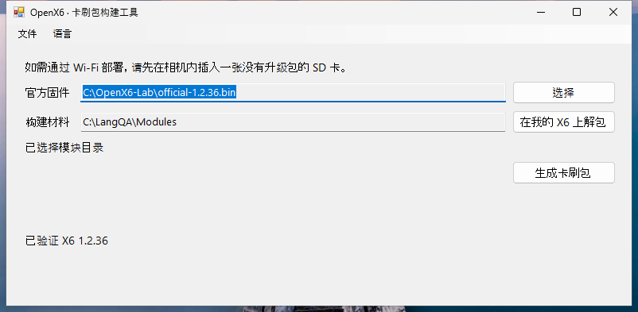

Windows 默认缓存为 `%LOCALAPPDATA%\OpenX6\Camera\X6-1.2.36-modules`。保留三个文件及其原名；可在其他电脑选择该目录离线构建。[Windows 操作和身份备份说明](desktop-runtime/windows/NATIVE-HOLDER.md)

## 更新桌面工具

Mac 和 Windows 启动时会检查新的稳定版。选择 **文件 → 更新至 …** 即可下载、校验并打开新版，也可以从 **文件 → 检查更新** 再查一次。Holder 和相机模块缓存会沿用。

如需手动更新，从同一正式发行页下载对应平台的 ZIP 和 `SHA256SUMS`，解压前核对 ZIP 摘要。Mac 可运行 `shasum -a 256 OpenX6-macOS-arm64.zip`，Windows PowerShell 可运行 `Get-FileHash .\OpenX6-Windows11-x64-native.zip -Algorithm SHA256`。[OpenX6 桌面版下载](https://github.com/OpenX6/OpenX6/releases)

- **Mac**：退出 OpenX6，解压新版 ZIP，替换「应用程序」里的 OpenX6。首次打开按上文操作。
- **Windows 11 x64**：退出 OpenX6，将新版 ZIP 完整解压到新目录，用原 Windows 账户运行其中的 `OpenX6.exe`。如使用快捷方式，请将其指向新目录。

保留原位置的 Holder 和模块缓存。桌面更新仅在电脑上生效；要更新机身，请用新版工具生成并安装卡刷包。

## 构建使用哪个固件文件

请从 Insta360 下载 `Insta360X6FW-338ADAFCENC.bin` 到电脑。文件大小为 **1,734,100,608 字节**，SHA-256 为 `2c0b9685f2861455d9f248bf2b8897b24c8fba05dd79662deee0796b0dbd6853`。产品下载页可能默认展示新版，请使用下面的 1.2.36 专用链接。**不要把官方固件包拷入 SD 卡。** [官方 X6 1.2.36 下载](https://wassets.insta360.com/common/1903f1acc9b648e18c14b3457bcd8504/Insta360X6FW-338ADAFCENC.bin) · [Insta360 X6 下载页](https://www.insta360.com/cn/download/insta360-x6)

两个构建档位都只接受官方加密的 X6 **1.2.36** 包。桌面工具按整个文件的 SHA-256 识别版本。选中官方 **1.3.59** 时会显示版本并在解密前停止，重新选择 1.2.36 即可继续。未知摘要的文件即使改名也会被拒绝。

## 哪些相机可以安装正式包

可安装版 OpenX6 面向两类 X6：

- **首次安装**：支持出厂 **v0.8.825 和 v0.8.827**。安装器会核对固件版本、升级器 SHA-256 和分区布局。已在一台运行原厂 v0.8.827 的 X6 上成功首装。0.8.827 机内解包已通过离线测试，待实机验证。
- **后续更新**：已运行兼容的 OpenX6 改装固件，并保有 SD 卡明文维护入口。

仍运行原厂 **1.2.36** 或 **1.3.59** 的相机会拒绝这种明文卡刷。请分别核对 Mac 上用于构建的文件和相机当前运行的固件。开发者工具生成的候选包带安装锁，可供离线验证。

## 插卡后没有反应

1. 按上文核对机身当前固件是否支持安装。屏幕若已显示检查或更新，请保持供电、留卡等待完成。
2. 确认相机空闲后，在电脑上查看 SD 卡。根目录应有本次**生成的卡刷包**，完整文件名为 `Insta360X6FW.bin`。用**本次构建**的 `RESULT.json` 中的 `sha256` 字段核对卡上文件。桌面 ZIP、官方输入文件各有自己的摘要。
3. 旧卡根目录若同时存在新的 `Insta360X6FW.bin` 和残留的隐藏包 `.x6-owner-package.bin`，协调器可能停止处理。Mac Finder 按 **Command–Shift–句号**，Windows 资源管理器选择 **查看 → 显示 → 隐藏的项目**。最简单的重试方法是换一张根目录只放已核验卡包的备用卡。若要复用原卡，请确认两个文件同时存在、相机没有升级任务，再把旧隐藏包备份到电脑后移出卡。只看到隐藏包时请保留，它可能仍由安装流程使用。
4. 安全弹出 SD 卡，再插回已开机的相机。安装完成后留卡重启会防止重复安装。若仍空闲，可以留卡正常重启；若接 USB 电源后停在充电画面，短按一次电源开机。

## 已经装过 OpenX6，怎样更新

仅更新电脑上的工具时，退出旧应用，在 Mac 上打开新版应用，或在 Windows 本地盘上将新版 ZIP 完整解压到新目录。相机上的功能在下一次 SD 安装后生效。

1. 先核对发布说明里支持的旧版和官方构建输入。基于 1.2.36 的功能更新可复用原官方文件及已校验的相机模块缓存。备份并沿用首次构建时的整个 `Holder` 目录，换电脑时先恢复备份。Mac 的身份位于上文列出的应用支持目录。[Windows 身份备份位置](desktop-runtime/windows/NATIVE-HOLDER.md)
2. Windows 用原账户打开完整解压的新版 OpenX6.exe 即可。原生版使用当前 Windows 账户的 DPAPI，Holder 位于 `%LOCALAPPDATA%\OpenX6\Native\Holder`。早期 WSL 用户请保留原构建环境与身份备份。当前原生版尚不支持导入 WSL Holder。
3. 用新版普通用户工具在新的空输出位置生成卡刷包。确认 `RESULT.json` 记录 `Insta360X6FW.bin`、`installer_kind=guard-ready` 和 `install_allowed=true`。**不要把 Insta360 官方固件包拷入 SD 卡。** 只将输出目录中的 `OpenX6 SD Build/Insta360X6FW.bin` 拷到卡根目录，安全弹出后再插入相机。准备更新和安装期间保持供电和 SD 卡就位，等待相机完成重启；如进入充电画面，用电源键正常开机。
4. 同一 OTA 数值版本也可以发布功能更新。用本次 `RESULT.json` 的 `release`、包摘要和发布说明识别构建。开机后核对新增功能、已有设置以及自己使用的管理入口。

## 模块框架开发预览

模块 SDK 和开发者工具还在开发中，清单格式和菜单接口都可能调整。现在可以从[录像容量估算示例](sdk/examples/recording_budget/module.json)入手：在电脑上预演相机菜单，选择一个码率，再运行示例里的 Python 程序，看一小时录像预计占用多少空间。这一步只需要 Python 和仓库源码。[试做第一个模块](sdk/README.zh.md#用-python-创建第一个模块)

要验证模块能否与其他改动一起构建，可以在开发者工具里同时选中几个模块，用官方 1.2.36 构建，再从成品读回菜单、程序和启动服务。开发者候选包带安装锁，供离线检查；当前供用户安装的卡刷包只包含内置模块。

**后续方向。** 我们希望作者只需维护自己功能的菜单、程序和测试。例如，贡献一个新的间隔拍摄设置时，作者可以声明适用的固件、需要保存的值，以及用户选择该项后程序应执行的操作。核心负责核对官方输入、检查模块之间的冲突，并在用户电脑上组包和校验。长期目标是让用户也能在桌面工具里选择兼容的社区模块，和内置功能一起生成可安装的卡刷包。

## 开发者工具的示例构建

第一次写模块，可以先在仓库根目录执行 `python3 -B -m sdk init ../field_budget`，然后用 `python3 -B -m sdk check ../field_budget/module.json` 检查。准备好菜单和程序后再选择官方包。[模块入门](sdk/README.zh.md#用-python-创建第一个模块)

1. 准备 Apple Silicon Mac、含 Tk 的 Python 3.11 或更高版本、OpenSSL 3 和 e2fsprogs。提前装好工具后即可离线操作。运行 `python3 -m tkinter -ApplePersistenceIgnoreState YES` 应能打开测试窗口，随后关闭即可。OpenX6 支持 Apple Silicon Homebrew 的默认路径，也支持 PATH 上的 e2fsprogs 和由 `OPENX6_LIBCRYPTO` 指定的 OpenSSL 3 库。请在 Mac 本地磁盘预留 **20 GiB**。
2. 准备官方 X6 **1.2.36** 和桌面工具从机内导出的三个模块，模块放在仓库外的同一目录。
3. 双击 **OpenX6 Desktop.command**，或在本目录运行 `python3 -B -m openx6.desktop`。首次示例保持「完整 OpenX6 构建」未勾选。选择「官方包」后程序会自动校验，等到显示「已验证 X6 1.2.36」，再选择「机内导出模块目录」。
4. 点「添加」选中 [stock_debug_label.json](sdk/examples/stock_debug_label.json)，点「生成锁定候选包」。选择仓库外可写的输出父目录，其中不能已有 `OpenX6 Build`。保持窗口打开，直到显示已校验的输出路径。
5. 在生成的 `OpenX6 Build` 目录执行 `shasum -a 256 -c SHA256SUMS`。打开 `RESULT.json`，确认档位为 `stock-example`，模块为 `stock_debug_label`，守卫为 `abort-only`，且 `install_allowed` 为 `false`。两个升级脚本都会直接中止。请将候选保留在电脑上作离线检查。

若模块目录被拒绝，请确认其中只有三个原名、未经修改的文件。模块基础摘要不符时，核对是否选了另一个构建档位的示例。模块冲突时，从列表移除其中一份再试。切换构建档位会清空已选模块。

带原生菜单的开发者构建完成后，窗口会从候选包重建菜单，并核对模块程序和启动服务。看到「成品读回通过」 和所选模块 ID 即通过。Windows 11 x64 可用同一份 240 Mbps 示例复测。[Windows 验收步骤](desktop-runtime/windows/acceptance/WINDOWS-TEST.md)

## 完整 OpenX6 构建（本地审查）

勾选「完整 OpenX6 构建」。除固件和材料外，还要选择持有者公钥配置 `owner-public.json`。初次使用可点「新建身份」，在仓库外生成 `OpenX6 Holder`；整个目录含私钥，请妥善备份。已有身份直接选原配置。

此档位还需要支持 `ssh-keygen -Y` 的 OpenSSH、Go **1.27.3**、LLVM clang 和 llvm-strip（实测 **22.1.4**）、支持 GNU 链接模式的 LLD，以及 Zig **0.17.0**。请提前安装，保证 PATH 能找到 Go 和 Zig。程序也会检查 Homebrew 的 llvm/lld 路径和 Mac 上已安装的稳定版 rustup 链接器。可用 `OPENX6_LLD` 指定 LLD 可执行文件。

选 [media_debug_label.json](sdk/examples/media_debug_label.json)，它在内置补丁之后应用。按上面的步骤构建、核验。结果应为 `unified`、`guard-locked`、`install_allowed: false`。此档位使用统一包的持有者组件和安装守卫。本轮验收范围为生成和回读成品。

程序使用组件预览公钥验证输入清单。镜像内验证项目更新使用另一把公钥。16K Fast RAW 在转换时读取该张 DNG 自己的颜色信息并保留校正图；画质验证范围见组件来源审查。

开发者也可以选用原生菜单示例，把统计开关接入单独的模块页。[示例清单](sdk/examples/stats_overlay.json) · [开发步骤](sdk/README.zh.md#构建相机原生菜单项)

要贡献带独立保存值的单选设置，可从 [Field checklist 示例](sdk/examples/field_checklist.json) 开始。它支持电脑预演和多个模块同时构建，也提供独立读取示例。[开发步骤](sdk/README.zh.md#让模块拥有自己的单选设置)

要让菜单选择驱动自己的程序，可从完整的码率与存储预算模块开始。[可执行模块开发步骤](sdk/README.zh.md#用菜单驱动自己的程序)

## 许可证

OpenX6 自有的构建核心、桌面构建器和内置相机改动按 GPL 第 3 版（`GPL-3.0-only`）发布。模块 SDK、插件模板及随附的示例插件使用 Apache 2.0。官方固件及第三方组件沿用各自的授权。[核心许可证](LICENSE) · [插件许可证](sdk/LICENSE) · [适用范围与第三方声明](NOTICE.md)

## 致谢

感谢 derrickyau9 和贡献者公开 Luna Ultra 的研究，为 Insta360 相机研究提供了参考。[上游研究项目](https://github.com/derrickyau9/insta360-luna-ultra-reverse-engineering) · [第三方说明](NOTICE.md)

开发者可在仓库根目录执行 `python3 -B -m unittest discover -s tests` 和 `python3 -B -m unittest discover -s sdk`。两组测试均使用本地样本。

### 用 SD 卡选择下一次启动模式

支持此功能的构建默认正常加载 Mod。需要排障时，在可写 SD 卡根目录创建纯文本文件 `OPENX6-BOOT.TXT`，单独写一行 `LEVEL1`（一次启动跳过 Mod 功能层）、`LEVEL2`（一次启动进入救援）或 `NORMAL`（取消待执行请求，恢复正常启动）。

相机开机后退出 USB 文件传输，插入卡，让相机读取几秒，再正常重启。受理后，相机会把卡上的请求改名为 `OPENX6-BOOT.READY`，保留原文字。文件仍叫 `.TXT` 表示请求尚未确认。保护只持续这一次启动，留卡再正常开机也会恢复 Mod。当前已在保护模式时，直接正常重启即可。

二级保护下，热点的 23456 端口仍提供 root 命令服务。相机会通过维护 SSH 或热点服务在机内验证 root，两者任一通过且升级器空闲，即可把新槽标记成功；两者都失败时暂缓标记。
